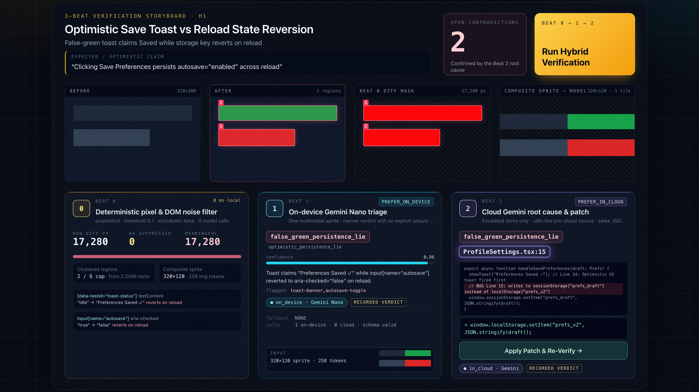
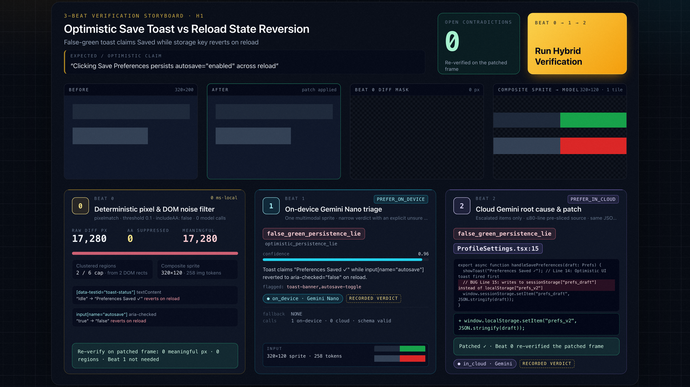
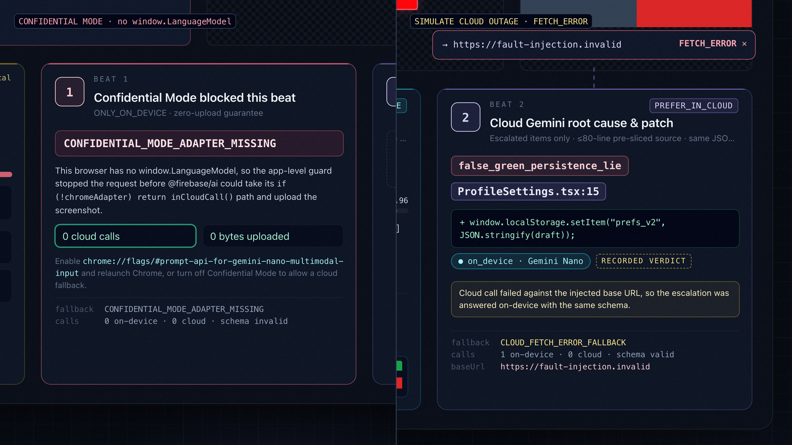
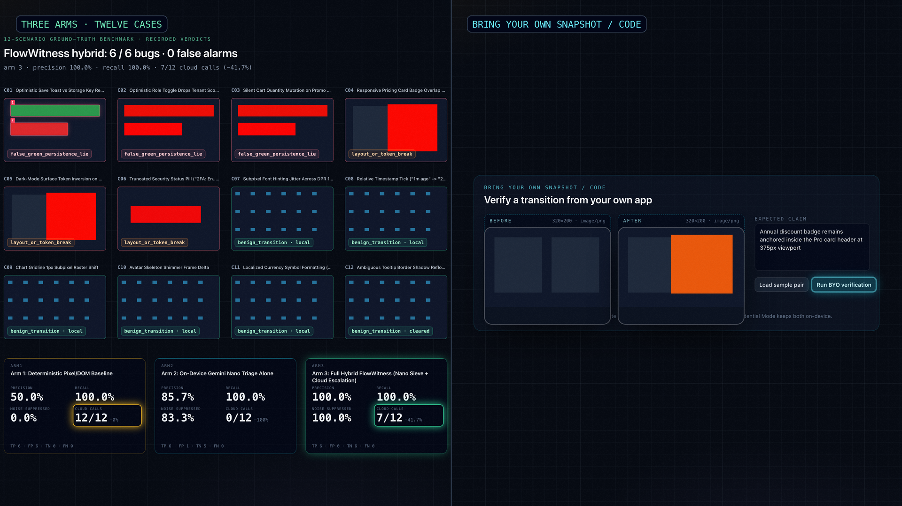

# FlowWitness — Browser-Native Hybrid UI & State Verification Workbench

[Live Workbench (`firebase-flow-witness.vercel.app`)](https://firebase-flow-witness.vercel.app) · [42s Demo Film (`youtu.be/2H3QmFD4D20`)](https://youtu.be/2H3QmFD4D20) · [繁體中文文件](/README.zh-TW.md) · [Architecture Glossary](/docs/glossary.md) · [ADR-0001: Hybrid Inference Gateway](/docs/decisions/0001-hybrid-inference-gateway-and-schema-compiler.md) · [ADR-0002: Transition Snapshot Pair](/docs/decisions/0002-transition-snapshot-pair-and-pre-sliced-escalation.md) · [Devpost Submission Writeup](/devpost/DEVPOST_SUBMISSION.md)

**FlowWitness** is a browser-native hybrid UI and state verification workbench built for the [Google #BuildHybridAI 2026 Hackathon](https://firebasehybridaihackathon.devpost.com/) using the official [Firebase AI Logic Web SDK](https://firebase.google.com/docs/ai-logic/hybrid-in-cloud-on-device) (`firebase/ai` v13.x+ / `@firebase/ai@3.0.0`) and [Firebase App Check](https://firebase.google.com/docs/app-check).

Instead of treating Chrome's Built-in Gemini Nano (`window.LanguageModel`) as a passive offline backup when Wi-Fi drops, **FlowWitness** splits visual and state verification across two complementary intelligence tiers:

1. **Beat 0 — Deterministic Pixel & DOM Diff (`0 ms`)**: Uses `pixelmatch({ threshold: 0.1, includeAA: false, diffMask: true })` to strip subpixel anti-aliasing noise deterministically, extracts DOM state deltas, and clusters remaining changed regions into a single numbered `<= 384×384 px` composite sprite sheet (`1` Gemini image tile = `258` tokens).
2. **Beat 1 — On-Device Gemini Nano Triage Sieve (`PREFER_ON_DEVICE` / `ONLY_ON_DEVICE`)**: Evaluates each transition locally in Chrome with a narrow structured JSON contract (`verdict: enum[benign_transition, false_green_persistence_lie, layout_or_token_break, unsure]`). Benign transitions melt away locally at `$0` cloud cost and `0` full-screen image uploads; only genuine contradictions or `unsure` edge cases escalate.
3. **Beat 2 — Cloud Gemini Root-Cause Diagnosis & Live Patch Re-Verification (`PREFER_IN_CLOUD`)**: Escalates flagged transitions with a deterministic pre-sliced component source and design-token snippet (`<= 80` lines) to Cloud Gemini. Clicking **Apply Patch & Re-Verify** renders the patched state/CSS side-by-side and re-runs Beat 0 (`0` meaningful diff pixels, `0` regions, settling immediately without a redundant Beat 1 call) to confirm `0` remaining contradictions.

---

## Visual Walkthrough & Demo Film

- **42-Second Launch & Demo Film**: [Watch on YouTube (`https://youtu.be/2H3QmFD4D20`)](https://youtu.be/2H3QmFD4D20)
- **Live Interactive Workbench**: [Open `https://firebase-flow-witness.vercel.app`](https://firebase-flow-witness.vercel.app)

| 1. 3-Beat Verification Storyboard (`H1` Persistence Lie) | 2. One-Click `Apply Patch & Re-Verify` (`2 → 0` Contradictions) |
| --- | --- |
|  |  |
| **3. `ONLY_ON_DEVICE` Leak-Zero Guard & `PREFER_IN_CLOUD` Fallback** | **4. 12-Scenario 3-Arm Benchmark & BYO Dropzone** |
|  |  |

---

## Key Architectural Innovations Around `@firebase/ai@3.0.0`

Detailed source-level verification and trade-offs are documented in [ADR-0001](/docs/decisions/0001-hybrid-inference-gateway-and-schema-compiler.md) and [ADR-0002](/docs/decisions/0002-transition-snapshot-pair-and-pre-sliced-escalation.md):

| Engineering Challenge in `@firebase/ai@3.0.0` | FlowWitness Architectural Solution |
| --- | --- |
| **`ONLY_ON_DEVICE` Silent Cloud Leak**: When `window.LanguageModel` is undefined, `chromeAdapterFactory` returns `undefined` and `callCloudOrDevice()` executes `if (!chromeAdapter) return inCloudCall()` before checking `ONLY_ON_DEVICE`. | [src/core/flow-witness-engine.ts](/src/core/flow-witness-engine.ts) enforces an application-level guard (`CONFIDENTIAL_MODE_ADAPTER_MISSING`) that blocks execution with `0` cloud requests when `window.LanguageModel` is absent. |
| **Dual-Target `Schema.object()` Serialization**: `ObjectSchema` stores `optionalProperties` on the class instance and only converts them into standard JSON Schema `required: [...]` inside `.toJSON()`. | `buildHybridModelParams()` compiles a single `Schema.object()` into `inCloudParams.generationConfig.responseSchema` and `onDeviceParams.promptOptions.responseConstraint` via `JSON.parse(JSON.stringify(schema))` with `omitResponseConstraintInput: true`. |
| **Concurrent On-Device Session Destruction**: `ChromeAdapterImpl.createSession()` calls `this.oldSession.destroy()` on every request, aborting concurrent calls. | All hybrid inference calls pass through a `runId`-fenced concurrency-1 FIFO mutex (`maxConcurrentOnDevice <= 1`), while `studioReducer` in [src/core/studio-model.ts](/src/core/studio-model.ts) discards stale async completions (`P4`). |
| **Honest `PREFER_IN_CLOUD` Fallback Under Cloud Outage**: `ChromeAdapterImpl.isOnDeviceRequest()` rejects `functionResponse` parts, and overriding `window.fetch` breaks on-device `fetch("data:image/...")` decoding and triggers App Check's 24-hour lockout. | Beat 2 embeds pre-sliced source/tokens (`<= 80` lines) in a single-turn request, binds single-target cloud (`ONLY_IN_CLOUD`) and on-device slots so unconfigured environments never fabricate `in_cloud` receipts, and injects cloud faults via per-request `SingleRequestOptions.baseUrl = "https://fault-injection.invalid"`, falling back cleanly to `"on_device"`. |

---

## 3-Arm Benchmark Results (12-Scenario Ground-Truth `caseMatrix`)

Evaluated via `evaluateBenchmarkMatrix()` in [src/core/flow-witness-engine.ts](/src/core/flow-witness-engine.ts) across `12` ground-truth transition scenarios (`6` true bugs: `3` optimistic persistence lies + `3` responsive layout/token breaks; `6` benign controls: `3` subpixel anti-aliasing shifts + `3` dynamic timestamp/locale updates):

| Evaluation Arm | Bug Recall (`6` Bugs) | Precision | Benign Noise Suppression (`6` Controls) | Cloud Calls Used (`12` Cases) | Cloud Call Reduction |
| --- | --- | --- | --- | --- | --- |
| **Arm 1: Deterministic Pixel/DOM Baseline** | `100.0%` (`6/6`) | `50.0%` (`6/12`) | `0.0%` (`0/6`) | `12` | `0.0%` |
| **Arm 2: On-Device Gemini Nano Triage Alone** | `100.0%` (`6/6`) | `85.7%` (`6/7`) | `83.3%` (`5/6`) | `0` | `100.0%` |
| **Arm 3: Full Hybrid FlowWitness (Beat 0 + Beat 1 + Beat 2)** | **`100.0%` (`6/6`)** | **`100.0%` (`6/6`)** | **`100.0%` (`6/6`)** | **`7`** | **`41.7%`** |

- **Why Arm 3 beats both single-tier arms**: On-device Gemini Nano (`Beat 1`) filters `5/6` benign transitions locally (`0` cloud calls) and outputs `unsure` on `1` ambiguous tooltip shadow control (`C12`) and `2` subtle bugs (`C03`, `C06`). Cloud Gemini (`Beat 2`) resolves the `unsure` escalations, achieving `100.0%` Precision and `100.0%` Recall while cutting cloud calls by `41.7%` (and reducing per-screen image tokens by `90%+` via single-tile `<= 384×384` sprite batching).

---

## Quick Start & Reproducible Verification

### 1. Install & Run Unit + Property-Based Test Suite (`P1..P4`)

```bash
npm install
npm test
npm run typecheck
```

The test suite in [tests/flow-witness-engine.test.ts](/tests/flow-witness-engine.test.ts) and [tests/studio-model.test.ts](/tests/studio-model.test.ts) verifies concrete capability examples, `fast-check` property invariants (`P1..P4`), and independent oracle negative calibration controls.

### 2. Run Interactive Workbench Locally

```bash
npm run dev
```

Open `http://127.0.0.1:3000` in desktop Chrome (works out-of-the-box on any browser via hybrid fallback, or with Chrome Built-in AI enabled via `chrome://flags/#prompt-api-for-gemini-nano-multimodal-input`).

#### Connect Firebase AI Logic (optional)

Create `.env.local` with `NEXT_PUBLIC_FIREBASE_API_KEY`, `NEXT_PUBLIC_FIREBASE_PROJECT_ID` and `NEXT_PUBLIC_FIREBASE_APP_ID` (plus `NEXT_PUBLIC_RECAPTCHA_SITE_KEY` for App Check), then rebuild. Firebase is initialised on the first cloud call, never on page load.

Without these values the cloud tier is off: Gemini Nano still answers on-device, and any beat no model could answer shows its recorded verdict labelled **Deterministic Replay (No Firebase Env)**, with a receipt that records `actualInferenceSource: "none"` and `0` cloud calls.

### 3. Run Headless Playwright E2E Verification (`4/4` Scenarios)

```bash
npm run build
npm run verify:e2e
```

The automated verifier in [scripts/verify_routing_e2e.mjs](/scripts/verify_routing_e2e.mjs) boots the production Next.js server and runs headless Chromium across all 4 verification flows, asserting `window.__FLOW_WITNESS_RECEIPTS__` integrity and `0` cloud leaks under `ONLY_ON_DEVICE`. Build without `.env.local` before running it: the verifier checks the deterministic no-Firebase path.

---

## License

Licensed under the [Apache License 2.0](/LICENSE).
