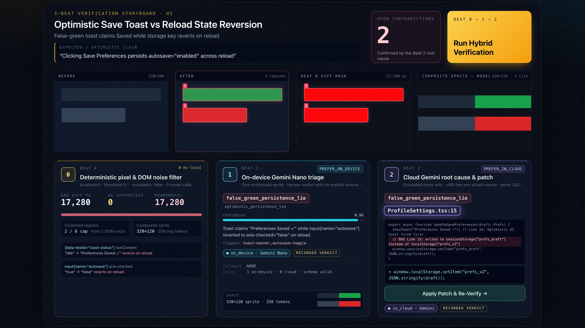
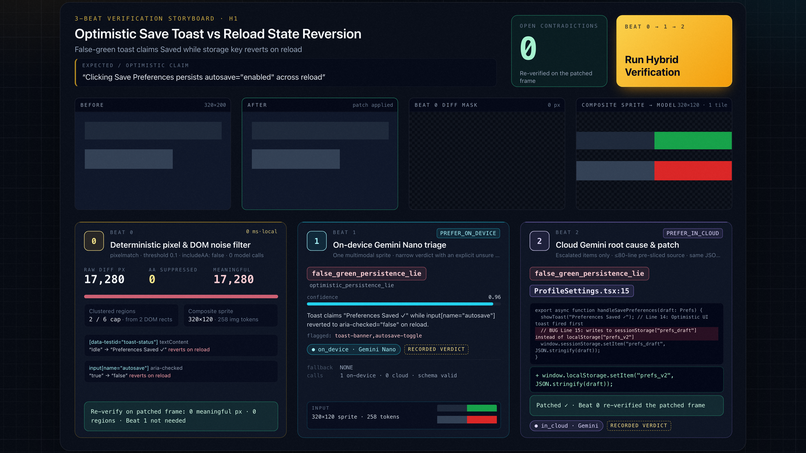
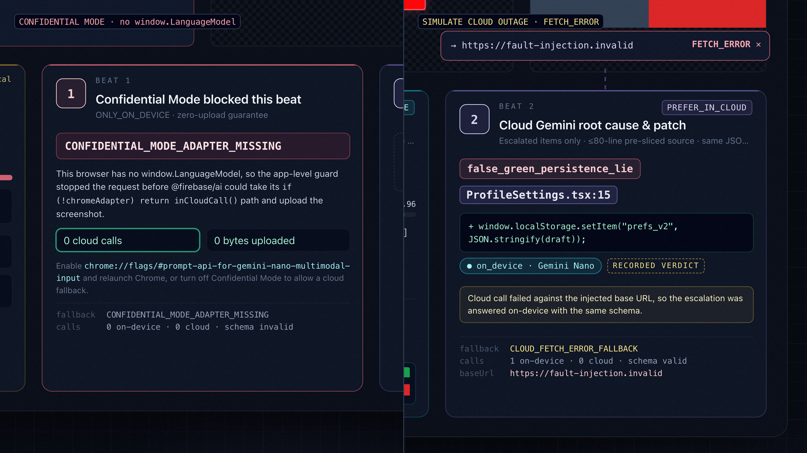
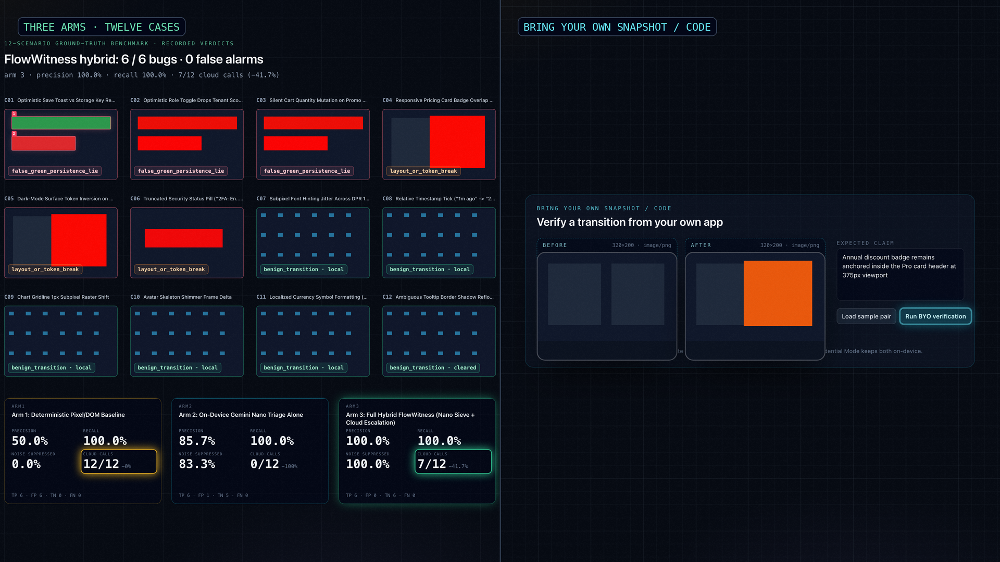

# FlowWitness — Devpost Submission Writeup (`#BuildHybridAI 2026`)

[Live Workbench (`firebase-flow-witness.vercel.app`)](https://firebase-flow-witness.vercel.app) · [42s Demo Film (`youtu.be/2H3QmFD4D20`)](https://youtu.be/2H3QmFD4D20) · [GitHub Repository](https://github.com/GGGODLIN/firebase-flow-witness) · [ADR-0001](https://github.com/GGGODLIN/firebase-flow-witness/blob/main/docs/decisions/0001-hybrid-inference-gateway-and-schema-compiler.md) · [ADR-0002](https://github.com/GGGODLIN/firebase-flow-witness/blob/main/docs/decisions/0002-transition-snapshot-pair-and-pre-sliced-escalation.md)

## Inspiration

Frontend developers and QA engineers constantly battle two verification failures that existing tools handle poorly:
1. **Optimistic Persistence Lies ("False Green")**: A settings form or toggle flashes a green `"Preferences Saved ✓"` toast immediately on click, yet silently writes to the wrong storage key or drops state on reload.
2. **Design-Token Drift Buried in Pixel Noise**: Running `pixelmatch` across responsive viewports produces 15–50 changed bounding boxes per screen—over 80% caused by subpixel font anti-aliasing or ticking timestamps. Streaming every full-resolution screenshot and DOM tree to a cloud LLM burns thousands of image tokens, adds multi-second latency, and leaks unreleased UI screens to external servers.

While inspecting the official `@firebase/ai@3.0.0` (`firebase@13.x`) Web SDK source code, we realized that hybrid inference shouldn't just be an "offline fallback when Wi-Fi disconnects." Instead, Chrome's on-device **Gemini Nano** and **Cloud Gemini** form a natural **Narrow Triage Sieve + Deep Root-Cause Diagnostician** pair—provided we solve the real browser constraints around session concurrency, JSON schema serialization, and privacy guards.

## What it does

**FlowWitness** is a browser-native hybrid UI & state verification workbench built on the official [Firebase AI Logic Web SDK](https://firebase.google.com/docs/ai-logic/hybrid-in-cloud-on-device) (`firebase/ai`) and [Firebase App Check](https://firebase.google.com/docs/app-check):

- **3-Beat Verification Storyboard**:
  - **Beat 0 (Deterministic Pixel & DOM Diff, `0 ms`)**: Runs `pixelmatch({ threshold: 0.1, includeAA: false, diffMask: true })` to strip subpixel anti-aliasing noise deterministically, extracts DOM state deltas, and packs up to `6` changed regions into a single `<= 384×384 px` composite sprite sheet (`1` Gemini image tile = `258` tokens).
  - **Beat 1 (On-Device Gemini Nano Triage, `PREFER_ON_DEVICE` / `ONLY_ON_DEVICE`)**: Evaluates the transition locally in Chrome under a strict JSON schema (`benign_transition | false_green_persistence_lie | layout_or_token_break | unsure`). Benign noise melts away locally at `$0` cloud cost; only genuine bugs or `unsure` edge cases escalate.
  - **Beat 2 (Cloud Gemini Root-Cause Patch & Live Re-Verify, `PREFER_IN_CLOUD`)**: Escalates flagged transitions with a deterministic pre-sliced component source snippet (`<= 80` lines) to Cloud Gemini (`gemini-3.5-flash-lite`), pinpointing the offending line and generating a minimal CSS/state fix. Clicking **Apply Patch & Re-Verify** applies the returned RFC 6902 JSON Patch to an executable example, reruns its storage/state/layout behavior, renders the result and requests Beat 1 again after Beat 0. Invalid patches remain failures; missing live model answers are disclosed rather than treated as model confirmation.
- **Bring Your Own Snapshot / Code Dropzone**: Developers can drop or paste their own `Before` and `After` screenshots (PNG/JPEG), expected claim, and component snippet to run the 3-Beat hybrid verification loop on their own projects.
- **Interactive Hybrid Resilience & Privacy Controls**:
  - **Confidential Mode (`ONLY_ON_DEVICE`)**: Guarantees `0` cloud bytes leave the browser when testing unreleased UI.
  - **Simulate Cloud Outage (`FETCH_ERROR`)**: Demonstrates `PREFER_IN_CLOUD` → `"on_device"` fallback mid-escalation via per-request `SingleRequestOptions.baseUrl` fault injection without breaking `data:` URL image decoding or App Check.
- **12-Scenario Ground-Truth Benchmark Drawer**: Compares `Arm 1 (Deterministic Baseline)`, `Arm 2 (On-Device Nano Alone)`, and `Arm 3 (Full Hybrid FlowWitness)` across 6 true bugs and 6 benign controls.

## How we built it

All live inference goes through official `firebase/ai` `getGenerativeModel()` with `PREFER_ON_DEVICE` / `ONLY_ON_DEVICE` for triage and `PREFER_IN_CLOUD` / `ONLY_IN_CLOUD` for cloud work. App Check initializes before AI, and cloud-capable requests require successful attestation. The executable benchmark uses independent settings, tenant-role, cart, pricing, modal, security, font, time, chart, skeleton, currency and tooltip examples.

The benchmark table uses **recorded expected verdicts**, not measured live-model accuracy. Verify Live requests actual inference and identifies replay or unanswered calls explicitly. Each true bug can be opened in the storyboard and patched; benign controls require no repair.

Local and Vercel setup require `NEXT_PUBLIC_FIREBASE_API_KEY`, `NEXT_PUBLIC_FIREBASE_PROJECT_ID`, `NEXT_PUBLIC_FIREBASE_APP_ID`, and `NEXT_PUBLIC_FIREBASE_APPCHECK_SITE_KEY`. `NEXT_PUBLIC_FIREBASE_AI_MODEL` optionally overrides `gemini-3.5-flash-lite`. Enable Firebase AI Logic, register App Check and enforce it in Firebase Console. Rebuild after setting public variables. Debug tokens are never bundled: only non-production localhost sessions without a site key accept a project-registered runtime `globalThis.FIREBASE_APPCHECK_DEBUG_TOKEN`. Site keys take precedence; production clears the debug flag. A ready local preference uses SDK device-only mode without a cloud-token prefetch.

We built **FlowWitness** with Next.js, React 19, TypeScript, `firebase/ai` (`@firebase/ai@3.0.0`), `firebase/app-check`, `pixelmatch`, and `fast-check` Property-Based Testing (`P1..P4`):

1. **Dual-Target `HybridContractCompiler` (`P1`)**: In `@firebase/ai@3.0.0`, `Schema.object()` stores `optionalProperties` on the class instance and only converts them into standard JSON Schema `required: [...]` when `.toJSON()` runs during `JSON.stringify()`. `buildHybridModelParams()` in [src/core/flow-witness-engine.ts](https://github.com/GGGODLIN/firebase-flow-witness/blob/main/src/core/flow-witness-engine.ts) compiles a single `Schema.object()` into both `inCloudParams.generationConfig.responseSchema` and `onDeviceParams.promptOptions.responseConstraint` (`JSON.parse(JSON.stringify(schema))` with `omitResponseConstraintInput: true`).
2. **Application-Level Confidential Leak-Zero Guard (`P2a`)**: In `@firebase/ai@3.0.0` (`index.esm.js:2551-2557`), `callCloudOrDevice()` checks `if (!chromeAdapter) return inCloudCall()` before checking `ONLY_ON_DEVICE`. When `window.LanguageModel` is absent, `chromeAdapter` is `undefined`, silently routing `ONLY_ON_DEVICE` calls to the cloud. `executeHybridInference()` intercepts `ONLY_ON_DEVICE` when `window.LanguageModel` is unavailable and blocks with `CONFIDENTIAL_MODE_ADAPTER_MISSING` (`0` cloud calls).
3. **Concurrency-1 FIFO Mutex & Epoch Fencing (`P2b` & `P4`)**: Because `ChromeAdapterImpl.createSession()` destroys any previous `LanguageModel` session (`this.oldSession.destroy()`), `executeHybridInference()` serializes requests through a concurrency-1 FIFO mutex while `studioReducer()` in [src/core/studio-model.ts](https://github.com/GGGODLIN/firebase-flow-witness/blob/main/src/core/studio-model.ts) fences async completions with a monotonic `activeRunId`.
4. **Per-Request `SingleRequestOptions.baseUrl` Fault Injection & Pre-Sliced Escalation**: Because `ChromeAdapterImpl.isOnDeviceRequest()` rejects `functionResponse` parts, Beat 2 embeds pre-sliced source/tokens (`<= 80` lines) in a single-turn `PREFER_IN_CLOUD` call and injects cloud outages via `SingleRequestOptions.baseUrl = "https://fault-injection.invalid"` rather than mutating `window.fetch`.

## Challenges we ran into

- **Preventing On-Device Session Self-Sabotage**: Early prototypes fired parallel `generateContent()` calls per diff bounding box, causing `ChromeAdapterImpl.createSession()` to abort in-flight sessions and stretching per-screen latency to ~60s. Clustering changed regions into a single `<= 384×384 px` composite sprite sheet and serializing calls through a FIFO mutex reduced Beat 1 to a single `258`-token request per transition.
- **Preserving `data:` URL Decoding and App Check During Fault Injection**: Overriding global `window.fetch` to simulate offline mode broke `ChromeAdapterImpl.toLanguageModelMessageContent()` (which calls `fetch("data:image/jpeg;base64,...")`) and triggered `@firebase/app-check`'s 24-hour token exchange lockout. Switching to `@firebase/ai`'s per-request `SingleRequestOptions.baseUrl` isolated fault injection cleanly to the cloud endpoint.

## Accomplishments that we're proud of

- **Recorded Routing Benchmark**: The table computes metrics over expected recorded verdicts for the independent examples. It illustrates the routing policy and does not measure live Gemini accuracy or savings. Live verification has separate SDK receipts and explicitly identifies replay.
- **Mathematically Verified Invariants (`P1..P4`)**: All four core invariants (dual-schema round-trip conservation, confidential leak-zero & concurrency-1 mutex, single-tile `<= 384×384` sprite geometry, and `activeRunId` epoch fencing) are verified by `fast-check` property-based tests and independent oracle negative calibration controls.

## What we learned

- On-device models shine brightest when given a **narrow structured classification contract with an explicit `unsure` escalation exit** rather than open-ended code generation.
- Reading the underlying SDK implementation (`@firebase/ai@3.0.0` and `@firebase/app-check@0.13.1`) is essential for building reliable hybrid AI systems that respect session lifecycles, token caching, and privacy boundaries.

## What's next for FlowWitness

- Packaging the Beat 0 + Beat 1 hybrid triage loop as a Playwright / Vitest visual-and-state assertion plugin (`expect(page).toPassFlowWitness(claim)`) for local CI/CD pipelines.
- Expanding multi-viewport responsive token diffing across mobile, tablet, and desktop breakpoints in a single composite sprite pass.
